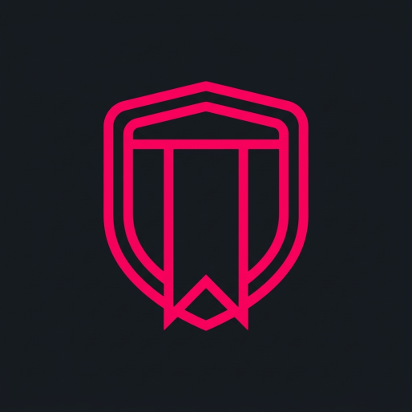

<div align="center">
  

  # Privacy NewTab

  **Minimalistyczna strona startowa z naciskiem na prywatność, kontrolę i prostotę.**

  [](https://opensource.org/licenses/MIT)
  [](https://newtab.eteryu.space)
</div>

Privacy NewTab to minimalistyczna, konfigurowalna strona startowa stworzona z myślą o prywatności i wygodzie użytkownika. Projekt łączy prosty interfejs z praktycznymi funkcjami, pozostawiając użytkownikowi kontrolę nad wyglądem, wyszukiwaniem i przechowywanymi danymi.

Inspiracją dla projektu był styl wizualny RedApp oraz funkcjonalność Hostux.page.

**[Otwórz Privacy NewTab](https://newtab.eteryu.space/)**

## Filozofia „Distrust”

Privacy NewTab powstał w duchu świadomego zaufania do technologii. Zamiast bezwarunkowo polegać na domyślnych rozwiązaniach, stawia na przejrzystość, lokalne przetwarzanie danych i kontrolę użytkownika.

- **Bez własnej analityki** – aplikacja nie zawiera własnych skryptów analitycznych ani mechanizmów śledzenia użytkowników.
- **Bez własnego backendu** – aplikacja nie wymaga serwera do przetwarzania ani przechowywania ustawień użytkownika.
- **Local-first** – ustawienia i dane użytkownika są przechowywane lokalnie w przeglądarce.
- **Bez zewnętrznych frameworków i bibliotek** – interfejs wykorzystuje czysty HTML, CSS i JavaScript.
- **Kontrola użytkownika** – możliwość wyboru wyszukiwarki, dodawania własnych usług, personalizacji wyglądu oraz eksportowania i importowania ustawień.

Prywatność nie powinna opierać się na ślepej wierze w deklaracje. Dlatego projekt udostępnia swój kod źródłowy do samodzielnej weryfikacji.

## Funkcje

- **Ciemny, minimalistyczny interfejs** – możliwość ustawienia własnego obrazu tła z dysku, z optymalizacją do WebP i zapisem w IndexedDB.
- **Tryb prywatny** – możliwość jednym kliknięciem rozmycia kafelków ze skrótami, aby ograniczyć ich widoczność dla osób postronnych.
- **Zegar i data** – duży, czytelny zegar, aktualna data oraz automatyczny wskaźnik popularnych świąt.
- **Dynamiczne powitanie** – tekst powitalny dostosowany do pory dnia.
- **Cytaty** – losowe cytaty związane z prywatnością i technologią.
- **Pasek wyszukiwania** – wygodny dostęp do wybranej wyszukiwarki.
- **Wybór wyszukiwarki** – lista obsługiwanych wyszukiwarek z możliwością zmiany domyślnego wyboru.
- **Własne wyszukiwarki** – możliwość dodawania własnych usług, np. prywatnej instancji SearXNG, poprzez podanie nazwy i adresu URL.
- **Kafelki ze skrótami** – możliwość dodawania ulubionych stron wraz z własnymi ikonami.
- **Kopia zapasowa ustawień** – eksport i import konfiguracji do pliku JSON, obejmujący m.in. tło, skróty, wyszukiwarki oraz ustawienia widoczności i kolejności sekcji.
- **Personalizacja widoczności sekcji** – możliwość niezależnego pokazywania i ukrywania trzech głównych sekcji: Powitania, Wyszukiwarki oraz Skrótów.
- **Zmiana kolejności sekcji** – możliwość ustawienia pozycji każdej z trzech sekcji (1, 2 lub 3). Wybranie zajętej pozycji automatycznie zamienia kolejność odpowiednich sekcji.
- **Zapisywanie układu** – ustawienia widoczności i kolejności sekcji są przechowywane lokalnie i zachowywane po ponownym uruchomieniu strony.
- **Uporządkowane menu ustawień** – pięć kategorii: Wygląd, Wyszukiwanie, Dane i kopie zapasowe, O projekcie oraz Wesprzyj projekt.
- **Informacje o projekcie** – bezpośredni dostęp do kodu źródłowego i strony Eteryu.space.
- **Dobrowolne wsparcie** – możliwość wsparcia dalszego rozwoju projektu przez Ko-fi. Korzystanie z aplikacji nie wymaga wpłaty.
- **Możliwość instalacji** – dzięki manifestowi aplikację można dodać do ekranu głównego urządzenia jako skrót lub aplikację, zależnie od możliwości przeglądarki.
- **Responsywność** – interfejs dostosowuje się do ekranów komputerów i urządzeń mobilnych.

## Wspierane wyszukiwarki

Projekt stawia na wolność wyboru i umożliwia korzystanie z wyszukiwarek dbających o prywatność:

- DuckDuckGo
- Startpage
- Brave Search
- Qwant
- SearXNG (lab042) – instancja udostępniona przez [@michal@101010.pl](https://101010.pl/@michal).

Dodatkowo można skonfigurować własną wyszukiwarkę, podając jej nazwę i adres URL zawierający parametr `%s` w miejscu wyszukiwanej frazy.

## Ustawienia

Menu ustawień zostało podzielone na pięć sekcji:

| Sekcja | Zawartość |
|---|---|
| **Wygląd** | Tło, widoczność i kolejność głównych sekcji |
| **Wyszukiwanie** | Domyślna wyszukiwarka i własne wyszukiwarki |
| **Dane i kopie zapasowe** | Eksport i import ustawień |
| **O projekcie** | Informacje o Privacy NewTab, kod źródłowy i Eteryu.space |
| **Wesprzyj projekt** | Informacje o dobrowolnym wsparciu przez Ko-fi |

Tryb prywatny pozostaje osobnym, szybko dostępnym przyciskiem na stronie głównej.

## Technologie

Projekt wykorzystuje standardowe technologie webowe, bez zewnętrznych frameworków:

- **HTML5** – struktura aplikacji.
- **CSS3** – stylowanie interfejsu, zmienne CSS, Flexbox, animacje i glassmorphism.
- **Vanilla JavaScript (ES6+)** – logika aplikacji.
- **Canvas API** – przetwarzanie obrazów tła.
- **IndexedDB** – lokalne przechowywanie tła i skrótów.
- **localStorage** – przechowywanie preferencji, własnych wyszukiwarek, widoczności i kolejności sekcji.
- **FileReader** – odczytywanie plików wybieranych przez użytkownika.
- **JSON** – format eksportu i importu konfiguracji oraz kopii zapasowych.
- **WebP** – optymalizacja obrazów tła.

## Roadmap – plany na przyszłość

- [x] Dodanie kafelków ze skrótami.
- [x] Optymalizacja obrazów tła do WebP.
- [x] Eksport i import ustawień do pliku JSON.
- [x] Możliwość tworzenia własnych wyszukiwarek.
- [x] Wdrożenie trybu prywatnego (rozmywanie kafelków).
- [x] Możliwość ukrywania i przywracania głównych sekcji strony.
- [x] Możliwość zmiany kolejności głównych sekcji.
- [x] Zapisywanie widoczności i kolejności sekcji w kopii zapasowej.
- [x] Przebudowa menu ustawień na osobne kategorie.
- [x] Dodanie sekcji informacyjnej o projekcie.
- [x] Dodanie sekcji dobrowolnego wsparcia projektu.
- [ ] Możliwość zmiany kolejności kafelków (Drag & Drop), z uwzględnieniem obsługi zdarzeń dotykowych na urządzeniach mobilnych.
- [ ] Stworzenie dedykowanego rozszerzenia do przeglądarki ułatwiającego podmianę domyślnej nowej karty.

## Struktura plików

```text
/
├── assets/
│   ├── icon-512.png          # główna ikona (PWA)
│   ├── favicon.ico           # ikona dla przeglądarek
│   ├── favicon.svg           # wektorowa ikona
│   ├── favicon-96x96.png     # ikona PNG
│   ├── apple-touch-icon.png  # ikona dla urządzeń Apple
│   └── og-image.png          # obraz dla mediów społecznościowych (Open Graph)
├── css/
│   └── style.css             # arkusz stylów
├── js/
│   ├── data.js               # statyczne dane (wyszukiwarki, cytaty, święta)
│   ├── db.js                 # obsługa bazy IndexedDB
│   ├── engines.js            # zarządzanie wyszukiwarkami i ich interfejsem
│   ├── background.js         # logika tła (Canvas, WebP, IndexedDB)
│   ├── shortcuts.js           # logika kafelków ze skrótami
│   ├── script.js              # główna logika aplikacji
│   └── backup.js              # logika eksportu i importu ustawień
├── index.html                # główny plik HTML
├── manifest.json             # konfiguracja PWA
├── README.md                 # ten plik
└── LICENSE                   # licencja MIT
```

## Licencja

Projekt jest udostępniany na licencji MIT. Szczegóły znajdują się w pliku [LICENSE](LICENSE).

## Inspiracje

- [RedApp](https://redapp.app/) – inspiracja stylem wizualnym.
- [Hostux.page](https://hostux.page/) – inspiracja układem i funkcjonalnością.

---

Privacy NewTab to niezależny projekt open-source. Jeśli okaże się przydatny, możesz wesprzeć jego dalszy rozwój. Wsparcie jest całkowicie dobrowolne — korzystanie z aplikacji nie wymaga wpłaty.

<div align="center">
  <a href="https://ko-fi.com/ETERYU">
    
  </a>

  **Prywatność zaczyna się od świadomych wyborów.**
</div>
