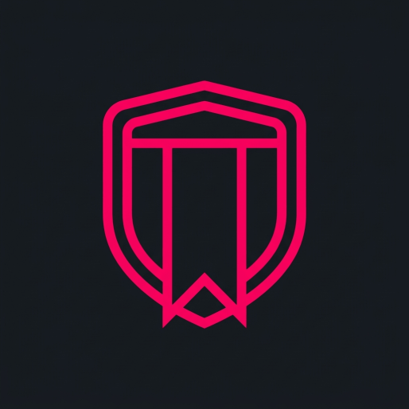

<div align="center">
  
  
  # Privacy NewTab
  
  **Minimalistyczna, w 100% prywatna strona startowa (New Tab).**

  [](https://opensource.org/licenses/MIT)
  [](https://newtab.eteryu.space)
</div>

Projekt open-source stworzony z myślą o pełnej prywatności i minimalizmie. Strona startowa inspirowana stylem wizualnym przeglądarki **RedApp** oraz funkcjonalnością **Hostux.page**.

## 🛡️ Filozofia "Distrust"

Projekt opiera się na zasadzie świadomego braku zaufania do domyślnych rozwiązań big tech:
- **Zero logów** – żadne dane nie są wysyłane na serwer.
- **Zero analityki** – brak jakichkolwiek skryptów śledzących.
- **Zero backendu** – wszystko działa lokalnie w przeglądarce (Local-first).
- **Zero zewnętrznych zależności** – brak frameworków CSS/JS, zewnętrznych czcionek czy bibliotek.

## ✨ Funkcje

- **Ciemne, minimalistyczne tło** – możliwość ustawienia własnego obrazu z dysku (z automatyczną optymalizacją do WebP i zapisem w IndexedDB).
- **Duży, wyraźny zegar i data** – z automatycznym wskaźnikiem popularnych świąt.
- **Pasek wyszukiwania** – umieszczony centralnie, pod zegarem.
- **Wybór wyszukiwarki** – rozwijana lista z prywatnymi wyszukiwarkami.
- **Kafelki ze skrótami** – możliwość dodawania ulubionych stron z własnymi ikonami.
- **Powitanie i cytaty** – dynamiczny tekst powitalny dostosowany do pory dnia oraz losowy cytat o prywatności.
- **PWA Ready** – możliwość zainstalowania jako aplikacja/skrót na telefonie (dzięki manifestowi).
- **Responsywność** – działa zarówno na desktopie, jak i na urządzeniach mobilnych.

## 🔍 Wspierane wyszukiwarki

Projekt stawia na wolność wyboru i wspiera narzędzia dbające o prywatność:
- DuckDuckGo
- Startpage
- Brave Search
- Qwant
- **SearXNG (lab042)** – serdeczne podziękowania dla [@michal@101010.pl](https://101010.pl/@michal) za udostępnienie instancji!

## 🛠️ Technologie

- Czysty HTML5
- CSS3 (zmienne, flexbox, animacje, glassmorphism)
- Vanilla JavaScript (ES6+, Canvas API, IndexedDB)
- `IndexedDB` (bezpieczne i pojemne przechowywanie tła i skrótów)
- `localStorage` (przechowywanie preferencji wyszukiwarki)

## 🗺️ Roadmap (Plany na przyszłość)

- [x] Dodanie kafelków ze skrótami.
- [x] Optymalizacja obrazów tła do WebP.
- [ ] Możliwość eksportu i importu ustawień (tła, skróty) do pliku JSON.
- [ ] Stworzenie dedykowanego rozszerzenia do przeglądarki (wtyczki) ułatwiającego podmianę nowej karty.

## 📁 Struktura plików

```text
/
├── assets/
│   ├── icon-512.png          # główna ikona (pwa)
│   ├── favicon.ico           # ikona dla przeglądarek
│   ├── favicon.svg           # wektorowa ikona dla nowoczesnych przeglądarek
│   ├── favicon-96x96.png     # ikona png
│   └── apple-touch-icon.png  # ikona dla urządzeń apple
├── css/
│   └── style.css             # arkusz stylów
├── js/
│   ├── data.js               # statyczne dane (wyszukiwarki, cytaty, święta)
│   ├── db.js                 # obsługa bazy IndexedDB (przechowywanie tła i skrótów)
│   └── script.js             # główna logika aplikacji
├── index.html                # główny plik HTML
├── manifest.json             # konfiguracja PWA
├── README.md                 # ten plik
└── LICENSE                   # licencja MIT
```

## 📄 Licencja

Ten projekt jest objęty licencją **MIT**. Szczegóły w pliku [LICENSE](LICENSE).

## 🙏 Inspiracje

- [RedApp](https://redapp.app/) – styl wizualny
- [Hostux.page](https://hostux.page/) – układ i funkcjonalność
